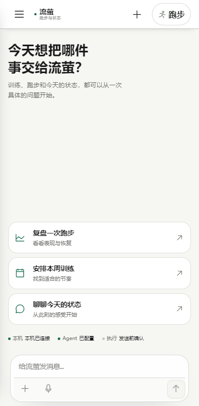
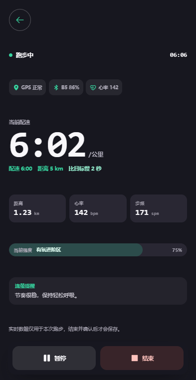
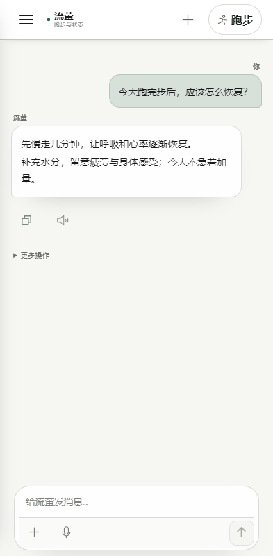
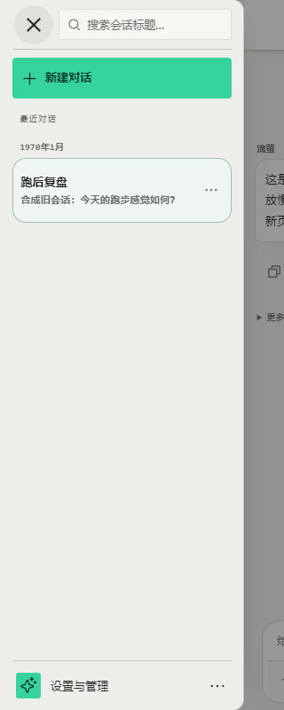

# 流萤 Agent

流萤是一款面向跑步与训练复盘的 Android App。你可以查看跑步中的配速、距离和心率，也可以在对话中复盘一次跑步、讨论本周训练安排，或梳理今天的状态。

## App 预览

| 流萤对话首页 | 跑步中 |
| --- | --- |
|  |  |
| 从常用问题开始，或输入自己的问题。 | 实时查看跑步指标。截图中的数值为演示数据。 |

## 对话页面

以下截图使用演示内容。

| 跑后恢复问答 | 会话列表 | 深色主题 |
| --- | --- | --- |
|  |  |  |
| 在聊天中讨论如何安排跑后恢复。 | 查找旧会话，或开启新对话。 | 查看深色主题下的对话界面。 |

## 项目结构

- [Android 客户端](app/)负责原生跑步流程、本机数据和 WebView 桥接。
- [Web 界面](frontend/)实现对话、跑步界面、历史记录和设置。
- [Agent 服务](agent-server/)负责在线任务、对话结果和工具调用。
- [接口契约](contracts/)记录客户端与服务之间的协议。

## 本地开发

使用 Node.js 22.22.2、Corepack（项目固定 pnpm 11.19.0）、JDK 17 和 Android SDK Platform 36。以下示例从仓库根目录在 PowerShell 中运行。

预览 Web 界面：

```powershell
Push-Location frontend
corepack pnpm install --frozen-lockfile
corepack pnpm dev
Pop-Location
```

浏览器可预览页面。跑步硬件、本机数据和原生桥接功能需要在 Android 环境中验证。

构建 Android 调试包并运行本机 JVM 单测：

```powershell
.\gradlew.bat :app:assembleDebug :app:testDebugUnitTest
```

运行前端和 Agent 服务的本地检查：

```powershell
Push-Location frontend
corepack pnpm check
Pop-Location

Push-Location agent-server
corepack pnpm install --frozen-lockfile
corepack pnpm check
Pop-Location
```

Worker 使用 [本地配置](agent-server/wrangler.jsonc)。自行部署时，以 [生产配置示例](agent-server/wrangler.production.example.jsonc) 为起点，填入自己的账号与 D1 数据库标识，并通过 Wrangler 单独设置所需密钥。

## 数据与授权

在线对话按聊天授权发送。涉及记忆、跑步摘要或插件时，可以在发送前核对本次请求的数据范围。需要确认的插件工具会在执行前展示参数。

## 许可证

项目代码使用 [MIT 许可证](LICENSE)。第三方资源遵循各自的许可，DeepSeek 词表工具附带 [上游许可声明](agent-server/tools/token-count/LICENSE.deepseek)。

内置语音文件经确认可随本仓库公开分发。项目代码的 MIT 许可范围不包含这些 MP3。
