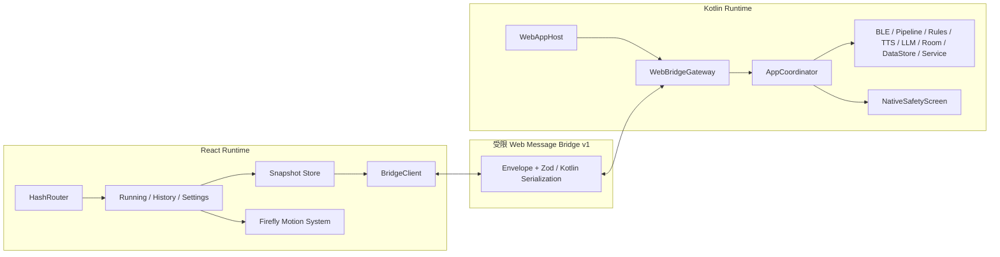

# 流萤 ReactBits 混合前端架构设计

- 日期：2026-08-26
- 状态：设计已确认，等待实施计划
- 适用项目：HealthyAgent / AI 跑步伴侣“流萤”
- 目标版本：首个 React 全量展示版本

## 1. 背景与目标

当前应用以 Kotlin、Jetpack Compose 为界面层，原生侧已经具备 BLE、跑步数据管线、规则引擎、TTS、LLM、Room、DataStore 和前台服务。此次升级不是用 Compose 模仿网页动画，而是在 APK 内引入真正的 React 运行时与 ReactBits 组件，同时保持现有原生业务核心和跑步安全链路。

本设计达成以下结果：

1. 跑步、历史、设置三个常规页面全部由 React 19、TypeScript 和 Vite 渲染。
2. ReactBits 官方组件源码以可追溯方式进入项目，形成“晨萤 / 夜萤”双主题和低调动效系统。
3. Kotlin 继续作为唯一业务真相，负责传感器、会话、规则、语音、存储和 Android 系统能力。
4. React 与 Kotlin 仅通过版本化 Web Message Bridge 通信。
5. WebView 重载或渲染进程故障不得中断正在进行的跑步。
6. React 失效时始终存在最小原生安全界面，可查看心率并暂停或结束跑步。

## 2. 非目标

本次不做以下事项：

- 不把 BLE、规则引擎、TTS、LLM、Room、DataStore 或前台服务迁移到 JavaScript。
- 不引入 React Native、Capacitor、远程 PWA 或在线托管页面。
- 不让 React 直接访问数据库、蓝牙、Android 权限或网络客户端。
- 不在多个 ReactBits 背景之间叠加 WebGL 特效。
- 不改写跑步计算、规则阈值、教练提示逻辑或传感器协议。
- 不依赖 CDN、远程字体或运行时下载的前端资源。

## 3. 已选方案与决策依据

采用“完整 React 展示层 + Kotlin 原生核心”方案。

未采用 React Native，因为 ReactBits 主要依赖 DOM、CSS、Canvas 或 WebGL，React Native 最终仍需要 WebView，反而增加第三层运行时。未采用 Capacitor/PWA，因为它会迫使项目重写 BLE、前台服务、TTS 和 Android 权限链路，风险与收益不匹配。未采用 Compose 动效复刻，因为用户要求使用真实 ReactBits 组件。

核心原则是：

> React 负责看见与交互；Kotlin 负责事实、动作与安全。

## 4. 目标架构



### 4.1 React Runtime

React Runtime 负责路由、页面组合、主题、无障碍和动画。它只保存渲染所需的最新不可变快照和短暂 UI 状态，不实现跑步状态机，不自行推导业务事实。

前端栈：

- React 19 + React DOM 19
- TypeScript 严格模式
- Vite
- React Router，使用 `HashRouter`
- Zustand，仅保存桥接快照与本地展示状态
- Zod，仅用于桥接边界运行时校验
- CSS Variables + CSS Modules
- Vitest + Testing Library + Playwright
- ESLint + Prettier
- pnpm，版本写入 `packageManager`

使用 `HashRouter` 是为了让 `https://appassets.androidplatform.net/assets/web/index.html#/run` 在静态 APK 资源中稳定工作，不要求 WebViewAssetLoader 提供服务端路由回退。

### 4.2 Kotlin Runtime

Kotlin Runtime 保留现有原生能力，并新增四个边界单元：

- `AppCoordinator`：暴露 `StateFlow<AppSnapshot>` 和 `execute(AppCommand)`，聚合现有会话、设置、历史和权限能力，但不依赖 WebView。
- `WebBridgeGateway`：执行协议校验、版本握手、命令路由、去重、结果编码和来源限制。
- `WebAppHost`：创建与销毁 WebView，配置 WebViewAssetLoader、消息监听器、导航限制和渲染进程故障处理。
- `NativeSafetyScreen`：Compose 实现的最小安全界面，仅展示当前心率、会话状态、暂停/继续和结束操作。

Web 桥接不直接调用 Compose ViewModel。现有 ViewModel 可在迁移期继续服务 Compose 页面，但最终由 `AppCoordinator` 直接依赖业务服务和仓库，以避免 UI 层互相调用。

### 4.3 业务真相归属

以下状态只允许 Kotlin 写入：

- BLE 连接状态
- 当前跑步会话与生命周期
- 心率、步频、配速、距离、时长和心率区间
- 规则触发结果和最新教练消息
- TTS 播放队列
- 历史记录和用户设置
- Android 权限状态
- 是否进入紧急或安全降级模式

React 可以提交命令，但不能乐观地把业务动作视为成功。按钮可显示 `pending`，最终状态必须来自 Kotlin 返回的结果或后续快照。

## 5. 推荐目录结构

```text
frontend/
  package.json
  pnpm-lock.yaml
  vite.config.ts
  src/
    app/
      App.tsx
      routes.tsx
      providers.tsx
    bridge/
      contract.ts
      schemas.ts
      BridgeClient.ts
      SnapshotStore.ts
    features/
      running/
      history/
      settings/
    design-system/
      tokens.css
      themes.css
      primitives/
    motion/
      MotionProvider.tsx
      FireflyParticles.tsx
      CoachReveal.tsx
      MetricTransition.tsx
    vendor/reactbits/
      Particles/
      SoftAurora/
      CountUp/
      BlurText/
      BorderGlow/
      FadeContent/
      ShinyText/
    test/

contracts/
  v1/
    fixtures/
    README.md

app/src/main/java/com/healthyagent/running/
  coordinator/
    AppCoordinator.kt
    AppSnapshot.kt
    AppCommand.kt
  bridge/
    BridgeEnvelope.kt
    WebBridgeGateway.kt
    BridgeError.kt
    CommandDeduplicator.kt
  ui/web/
    WebAppHost.kt
    HealthyWebViewClient.kt
  ui/safety/
    NativeSafetyScreen.kt
```

`frontend/dist` 和 Android 生成的 Web assets 都是构建产物，不提交到 Git。

## 6. Web Message Bridge v1

### 6.1 传输方式

- 页面由 `WebViewAssetLoader` 从 `https://appassets.androidplatform.net/assets/web/` 加载。
- 接收端使用 `WebViewCompat.addWebMessageListener`，允许来源仅为 `https://appassets.androidplatform.net`。
- 原生向页面发送消息时，目标来源必须是同一精确 origin。
- 不使用 `addJavascriptInterface`。
- 所有消息均为 UTF-8 JSON，单条消息上限 256 KiB。

Android 最低版本保持 API 26。启动时通过 `WebViewFeature.isFeatureSupported` 检查所需消息能力；能力缺失时不启动 React 页面，直接进入原生降级界面。

### 6.2 信封格式

所有消息共享以下字段：

```json
{
  "contractVersion": 1,
  "type": "command",
  "id": "uuid",
  "sentAt": "2026-08-26T12:00:00Z",
  "payload": {}
}
```

允许的 `type`：

- `hello`：React 声明协议版本和前端 build ID。
- `ready`：Kotlin 返回协议版本、能力列表和第一份完整快照。
- `snapshot`：Kotlin 返回带递增 `revision` 的完整展示快照。
- `command`：React 提交用户意图，`id` 同时作为 `requestId`。
- `result`：Kotlin 返回命令接受或结构化错误，关联同一 `requestId`。
- `event`：Kotlin 发送不应写入长期状态的一次性 UI 事件。

双方必须在边界严格校验信封和 payload。未知 `type`、超限消息、来源不符、字段缺失或版本不兼容均拒绝处理。

### 6.3 握手与重连

1. React 加载后发送 `hello`。
2. Kotlin 在 5 秒内返回 `ready` 和完整 `AppSnapshot`。
3. 握手完成前，React 仅显示本地启动骨架，不允许发送业务命令。
4. WebView 重载后重新握手；Kotlin 会话不重启，React 从新快照恢复。
5. 版本不一致或 5 秒超时时进入原生降级界面，不做无限自动重试。

### 6.4 快照

`AppSnapshot` 至少包含：

- `revision`、`generatedAt`
- `connection`
- `session`
- `metrics`
- `latestCoachMessage`，包含稳定消息 ID
- `settings`
- `permissions`
- `theme`
- `motionPolicy`
- `safetyState`

跑步时每秒发送一次完整快照，并在连接、暂停、继续、停止、权限和安全状态变化时立即发送。历史列表通过查询命令返回，不塞入每秒快照。

React 只接受 revision 更大的快照。若跑步中超过 3 秒未收到新快照，界面标记“数据暂时中断”，保留最后值但不继续自行计时或外推指标。

### 6.5 命令

首版命令集合：

- `device.connect`
- `device.disconnect`
- `run.start`
- `run.pause`
- `run.resume`
- `run.stop`
- `history.query`
- `settings.update`
- `permission.request`

命令结果表示“已接受”或“拒绝”，异步过程的最终事实仍由快照表达。例如 `device.connect` 被接受后，React 等待 `connection` 快照进入 `connecting` 或 `connected`。

Kotlin 维护当前进程内最近 128 个 `requestId` 的 LRU 结果缓存。相同 ID 重发时返回原结果，不重复执行开始、停止或设置写入。

标准错误码：

- `BRIDGE_VERSION_UNSUPPORTED`
- `INVALID_MESSAGE`
- `COMMAND_NOT_ALLOWED`
- `PERMISSION_REQUIRED`
- `SESSION_CONFLICT`
- `RESOURCE_UNAVAILABLE`
- `WEB_RUNTIME_FAILED`
- `INTERNAL_ERROR`

### 6.6 一次性事件

一次性事件只用于权限结果、短暂通知和非关键导航反馈。安全告警、TTS 和跑步状态不能只依赖事件：它们必须由 Kotlin 原生链路处理，并在快照中有可恢复表示。

`latestCoachMessage.id` 用于防止 WebView 重载后重复播放入场动效；TTS 播放完全由原生 SpeechBus 控制。

## 7. WebView 安全配置

Release 构建必须满足：

- 只加载 APK 内的 appassets origin。
- 禁止 `file://` 和 `content://` 访问。
- 禁止 mixed content。
- 拦截并拒绝非 appassets 顶层导航。
- 禁止任意弹窗、下载和新窗口。
- WebView 调试仅在 debug 构建启用。
- 页面不访问远程 API；所有业务数据通过桥接获得。
- 不在 Web bundle 中保存 API key、用户隐私数据或长期凭据。

Android 权限弹窗只能由 Kotlin 发起。React 通过 `permission.request` 表达意图，原生完成系统交互后返回结果和新快照。

## 8. Firefly Design System

### 8.1 主题

提供两套共享语义 token：

- `morning`：暖白底、柔和薄荷绿、低饱和紫，称为“晨萤”。
- `night`：近黑紫底、薄荷绿光点、克制紫色辉光，称为“夜萤”。

主题可跟随系统，也可由用户在设置中指定。选择保存在 Kotlin DataStore，React 只消费快照。两套主题共用组件结构和动效语义；浅色模式降低光晕透明度，不维护第二套动画逻辑。

主要数据与控制必须满足可读性优先：

- 主指标使用固定宽度数字，更新不得引起布局跳动。
- 关键按钮最小可点击区域为 48 × 48 CSS px。
- 支持系统字体缩放和安全区域 inset。
- 颜色不是状态的唯一表达方式。

### 8.2 真实 ReactBits 集成

ReactBits 采用官方仓库的 TypeScript 默认实现，以源码形式放入 `frontend/src/vendor/reactbits`。每个组件目录保留来源 URL、上游版本或 commit、许可说明和本地修改记录。

首版引入并实际使用以下官方组件；每个组件都必须经过产品语义封装：

- `Particles`
- `SoftAurora`
- `CountUp`
- `BlurText`
- `BorderGlow`
- `FadeContent`
- `ShinyText`

业务页面禁止直接 import `vendor/reactbits`。页面只能使用项目拥有的语义封装，例如 `FireflyParticles`、`CoachReveal`、`MetricTransition`。这样可以集中限制数量、时长、颜色、降级和可访问性。

### 8.3 MotionBudget

`MotionProvider` 计算四级预算：

- `expressive`：非跑步浏览场景，允许 `Particles` 最多 24 粒；`SoftAurora` 与 `Particles` 互斥。
- `balanced`：普通交互，保留轻量萤火虫，关闭不必要的指针追踪。
- `reduced`：跑步进行中，`Particles` 最多 12 粒、关闭指针交互，主指标无位移动画。
- `off`：紧急、安全降级、后台、系统 Reduced Motion、低电量或热状态受限时，不挂载 WebGL/Canvas 动效。

优先级固定为：

```text
紧急/安全 > 系统 Reduced Motion/省电/过热/后台 > 跑步进行 > 用户视觉偏好
```

事件动效规则：

- `BlurText`：新教练消息每个 ID 只播放一次，450 ms 内结束。
- `BorderGlow`：教练消息或连接成功时只扫过一遍。
- `ShinyText`：仅分段里程或目标达成时播放一个周期。
- `FadeContent`：页面首次进入时播放一次。
- `CountUp`：用于总结、里程碑和非高频累计值；跑步中的配速、心率不逐秒滚动。

同一屏幕最多存在一个持续 Canvas/WebGL 层。页面进入后台时停止 RAF；回到前台后根据最新预算重新挂载。

## 9. 页面与导航

React 提供三条路由：

- `#/run`
- `#/history`
- `#/settings`

Android 系统返回键优先交给 React Router；React 没有可返回历史时再交还 Activity。跑步中的停止操作必须经过明确确认，浏览器历史回退不能触发停止命令。

### 9.1 跑步页

跑步页展示连接状态、主配速、心率、步频、距离、时长、心率区间、教练消息和会话操作。页面只根据快照渲染，并通过命令请求连接、开始、暂停、继续和结束。

### 9.2 历史页

历史页通过 `history.query` 获取分页数据。首版不在 Web 端缓存完整历史数据库；页面刷新后重新查询 Kotlin Room。

### 9.3 设置页

设置页编辑教练性格、跑步目标、主题、动效偏好和 mock 场景等已有设置。提交 `settings.update` 后，以新快照为最终显示值。

## 10. 故障处理与安全降级

### 10.1 启动失败

资源缺失、WebView 功能不支持、握手超时或协议不兼容时：

- 未跑步：显示原生错误页和“重试”入口。
- 跑步中：直接显示 `NativeSafetyScreen`。

不循环自动重建 WebView。用户主动重试时创建新的 WebView 实例并重新握手。

### 10.2 渲染进程消失

`onRenderProcessGone` 必须释放失效 WebView，记录诊断信息，并根据当前会话状态选择普通错误页或安全页。原生前台服务、数据管线和 TTS 不依赖 WebView，因此继续运行。

### 10.3 桥接错误

非法消息只拒绝当前请求并记录有限诊断信息，不让 Web 内容导致原生进程崩溃。日志不得包含完整用户历史、API key 或传感器原始隐私数据。

### 10.4 安全告警

心率或规则引擎产生紧急告警时：

1. 原生 SpeechBus 优先播报。
2. Kotlin 把 `safetyState` 写入快照。
3. React 立即关闭装饰动效并显示静态高对比操作。
4. React 不可用时，原生安全页承担同样操作。

## 11. 构建与工程生态

### 11.1 构建流水线

Gradle 使用受控 Node 工具链，并通过 Corepack 使用 `packageManager` 中固定的 pnpm 版本。Android 构建新增以下任务关系：

```text
pnpm install --frozen-lockfile
  -> pnpm typecheck
  -> pnpm test
  -> pnpm build
  -> syncWebAssets
  -> merge<Variant>Assets
  -> assemble<Variant>
```

开发构建可跳过重复测试，但 release 和 CI 不得打包未经 `typecheck`、测试和 build 的 bundle。

Vite 输出复制到 `app/build/generated/webAssets`，并作为 Android 生成 assets 目录参与打包。生成目录和 `frontend/dist` 不进入 Git，避免陈旧 bundle 被误提交。

### 11.2 Feature Flag

迁移期保留 `WEB_UI_ENABLED` 构建开关：

- debug 默认允许在 React 与现有 Compose 页面之间切换，用于对照测试。
- release 在跑步页、历史页和设置页全部达到验收线前保持 Compose 默认。
- 全量验收后，release 默认切换到 React；普通 Compose 页面随后删除，原生安全页保留。

Feature Flag 只用于迁移和回滚，不成为长期双 UI 产品模式。

## 12. 测试策略

### 12.1 合同测试

`contracts/v1/fixtures` 保存 hello、ready、snapshot、command、result、event 和错误样本。相同 fixtures 同时由 Kotlin Serialization 与 Zod 测试读取，验证：

- 合法消息双方都接受。
- 缺字段、错误类型、超限和未知版本双方都拒绝。
- 序列化后 requestId、revision、时间和枚举不丢失。

### 12.2 React 测试

- Vitest：store、派生展示状态、MotionBudget 和错误映射。
- Testing Library：三屏关键状态、pending、错误、Reduced Motion 和键盘操作。
- Playwright：晨萤、夜萤、Reduced Motion 的稳定截图，以及三条路由的基本流程。
- 构建检查：不允许远程资源引用、bundle 中不允许密钥样式字符串。

### 12.3 Kotlin 测试

- `AppCoordinatorTest`：快照聚合与命令路由。
- `WebBridgeGatewayTest`：握手、来源、版本、去重和错误。
- `CommandDeduplicatorTest`：相同 requestId 不重复执行。
- 保持现有跑步数学、规则、会话和 SpeechBus 测试通过。

### 12.4 Android 仪器与端到端测试

- WebViewAssetLoader 能离线加载 bundle。
- Web Message Bridge 能完成握手、命令和快照往返。
- Activity 重建和 WebView reload 后跑步 session ID 不变。
- 模拟渲染故障后进入正确的原生降级页面。
- Pixel 6 模拟器使用 mock 传感器完成连接、开始、暂停、继续、停止、历史写入和设置修改。

## 13. 性能验收线

首版 release 构建目标：

- Pixel 6 模拟器冷启动至可见主界面不超过 1.5 秒。
- 首路由压缩后初始 JavaScript 不超过 450 KiB。
- 全部 Web 静态资源不超过 2.5 MiB，不含系统 WebView。
- 同屏最多一个持续 Canvas/WebGL。
- 10 分钟 mock 跑步 profiling 中不出现 50 ms 及以上的 Web 主线程长任务。
- 页面进入后台后不继续执行装饰 RAF。
- 跑步中触控按钮反馈在 100 ms 内出现 pending 状态。

性能不达标时优先减少或卸载 ReactBits 动效，不降低跑步数据刷新、安全播报或按钮响应。

## 14. 分阶段迁移

### 阶段 1：合同与工程骨架

- 建立 `frontend`、pnpm、Vite、测试和 Gradle assets 流水线。
- 定义 Bridge v1 fixtures 和双方解析测试。
- 建立 WebViewAssetLoader、安全 WebView 配置和 Feature Flag。

完成门槛：空 React shell 可离线加载，合同测试和现有 Android 单元测试通过。

### 阶段 2：AppCoordinator 与跑步页

- 建立 Kotlin `AppCoordinator` 和 `WebBridgeGateway`。
- 迁移跑步页的全部展示与操作。
- 完成 WebView reload、命令去重和 NativeSafetyScreen。

完成门槛：mock 跑步端到端流程与故障降级通过；现有 Compose 跑步页仍可由 Feature Flag 回退。

### 阶段 3：历史页与设置页

- 迁移分页历史查询。
- 迁移设置读写、主题和权限请求。
- 完成 Android 返回键与三路由导航。

完成门槛：三个 React 页面功能与现有原生页面对齐。

### 阶段 4：ReactBits 与性能

- 按来源记录引入选定 ReactBits 组件。
- 实现 Firefly Design System 和 MotionBudget。
- 完成双主题、Reduced Motion、截图和性能验收。

完成门槛：所有视觉、无障碍和性能指标通过。

### 阶段 5：默认切换与清理

- release 默认启用 React UI。
- 完成稳定性回归后删除普通 Compose 页面和不再使用的 UI ViewModel。
- 永久保留 Compose 宿主与 NativeSafetyScreen。

完成门槛：APK 离线运行、全部测试通过、模拟器端到端通过，且 WebView 重载不影响跑步记录。

## 15. 主要风险与缓解

### WebView 版本差异

通过 AndroidX WebKit feature detection 检查消息能力；不支持时降级，不尝试不安全兼容层。

### React 与 Kotlin 状态漂移

React 不拥有业务状态机；所有动作由命令提交，所有最终事实由 snapshot/result 返回。

### 动效造成耗电或掉帧

MotionBudget、单 Canvas 限制、后台卸载和紧急关停是硬约束；性能失败时首先削减装饰。

### 迁移期间双 UI 维护成本

Feature Flag 只存在于迁移期；每个页面达到对齐门槛后进入下一阶段，最终删除普通 Compose UI。

### 构建链增加 Node 依赖

Node 与 pnpm 版本固定，前端构建由 Gradle 和 CI 编排；release 不允许使用手工复制的旧 bundle。

## 16. 验收标准

满足以下全部条件才视为升级完成：

1. 跑步、历史、设置均由 React 渲染，使用真实 ReactBits 源码组件。
2. 晨萤、夜萤和 Reduced Motion 均可用且有视觉回归测试。
3. Kotlin 仍是 BLE、会话、指标、规则、TTS、LLM、Room、DataStore 和权限的唯一业务真相。
4. WebView 重载、Activity 重建和渲染进程故障不丢失或中断跑步会话。
5. React 不可用时，原生安全页能显示心率并暂停、继续或结束。
6. Bridge v1 合同测试在 Kotlin 和 TypeScript 两侧通过。
7. 现有原生单元测试、新增前端测试、Android 仪器测试和 Pixel 6 端到端测试全部通过。
8. APK 在无网络条件下加载完整 UI，不请求 CDN 或远程字体。
9. 达到第 13 节性能验收线。

## 17. 参考资料

- ReactBits 官网：https://reactbits.dev/
- ReactBits 官方仓库：https://github.com/DavidHDev/react-bits
- Android WebViewAssetLoader：https://developer.android.com/reference/androidx/webkit/WebViewAssetLoader
- Android WebViewCompat：https://developer.android.com/reference/androidx/webkit/WebViewCompat
