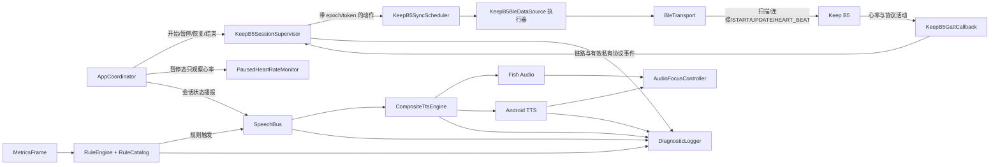

# 流萤 B5 会话与语音可靠性修复设计

- 日期：2026-09-05
- 状态：聊天设计已确认，等待书面规格复核
- 适用项目：HealthyAgent / 个人跑步伴侣“流萤”
- 本轮目标：修复长暂停后 B5 断连、恢复后不重连、规则播报完全缺失，并留下可跨重启追查的诊断证据

## 1. 背景与已确认事实

2026-09-04 的真机实测证明，手机 GPS、跑步计时和 B5 心率采集主体链路可工作，但存在三组相互独立的问题：

1. 暂停约 30 秒以内恢复时，B5 通常仍可用；暂停超过约 30 秒后，B5 会断开，恢复跑步也不会重新连接。
2. B5 能显示心率和时间，但公里数、配速与千卡为空。
3. 流萤没有开始、暂停、恢复、结束或每公里播报。

代码和设备日志已把根因收敛到以下位置：

- `KeepB5BleDataSource.onRunPaused()` 会停止私有 UPDATE_WORKOUT 与 HEART_BEAT，同步取消重连；暂停态又被 `isReconnectAllowed()` 排除，因此断开后不能恢复。
- `AppModule.kt` 连续注册 11 个无 qualifier 的 `single<Rule>`。Koin 4.0.2 使用相同索引键保存这些定义，后者覆盖前者，运行时实际只剩最后注册的 `GoalAchievedRule`。
- 开始、暂停、恢复、结束目前没有进入 SpeechBus；暂停和结束反而会直接停止语音。
- `AndroidTtsEngine.speak()` 在 Android 只接受播放请求时就返回成功，并没有等到 `onDone`；现有日志也无法跨进程重启保留。
- 当前 B3 UPDATE_WORKOUT 仅可靠编码运动状态与时长。已有静态分析和旧抓包不足以证明 `DisplayData.dataType=1/2/3` 与公里数、配速、千卡的映射及单位，不能据此写入猜测值。

## 2. 目标与验收边界

本轮交付必须达到：

1. 跑步暂停至少 60 秒时，B5 物理连接与心率采集保持；手机端时间、距离和配速冻结。
2. 暂停期间若 B5 意外断开，应用继续自动重连；恢复跑步后无需手动重连或重新开始会话。
3. 在 TTS 设置启用时，开始、暂停、恢复、结束与每公里事件均能进入真实 TTS 播放链路。
4. 11 条现有本地规则全部被构造，规则 ID 唯一，并由 RuleEngine 实际评估。
5. Fish Audio 未配置时不发起无效网络请求，直接使用 Android 本地 TTS。
6. 本地 TTS 以真实播放完成或失败作为结果；播报时临时请求可 duck 的音频焦点，结束后归还，并沿用系统当前输出设备。
7. BLE、规则仲裁与 TTS 的关键事件写入有限大小、可轮转、重启后仍存在的本地诊断日志。

本轮明确不承诺：

- 不猜测或伪造 B5 公里数、配速、千卡的 `DisplayData` 编码。
- 不更改 GPS 距离、配速、分段或 Room 持久化算法。
- 不重做 React 页面、主题或 ReactBits 动效。
- 不引入通用遥测平台、远程日志上传或账号体系。
- 不用任意默认体重估算千卡；若后续证明确需手机计算，先增加明确的体重设置。
- 不新增活动跑步中“只断开 B5、保留 GPS”的独立命令；现有活动态 `device.disconnect` 继续被拒绝。

## 3. 总体方案

采用已经确认的“双状态监督器 + 显式规则目录 + 可观测语音链路”。物理 BLE 链路和跑步生命周期不再共享一个 `isActive` 布尔值；规则实例不再依赖同类型 Koin 多重注册；SpeechBus 的每次接受、拒绝和播放结果都能被追踪。

核心归属保持不变：`AppCoordinator` 仍是应用会话的业务入口，`KeepB5BleDataSource` 仍实现传感器接口，React 仍只消费 Kotlin 快照。新增单元只收紧职责，不建立第二套业务状态。

## 4. B5 会话监督器

### 4.1 状态模型

新增纯 Kotlin 的 `KeepB5SessionSupervisor`。它持有两个相互独立的状态轴：

| 状态轴 | 状态 | 含义 |
| --- | --- | --- |
| 物理链路 | `Disconnected` / `Connecting(connectionPhase)` / `Ready(channelKind)` | 扫描、握手与数据通道是否可用；就绪后的 `channelKind` 为 `StandardHr` 或 `PrivateB3` |
| 跑步生命周期 | `Stopped` / `Running` / `Paused` | B5 上应呈现的运动会话状态 |

监督器同时保存：

- `frozenElapsedSeconds`：暂停时固定发送的训练时长。
- `maintainConnection`：开始跑步或跑步前显式连接时为 `true`；结束跑步或显式断开时为 `false`，是是否允许重连的唯一连接意图。
- `lastPrivateActivityAtMillis`：最近一次通过既有 fixture 所支持的 CRC 与 protobuf 结构校验的 B3 `WorkoutData` 通知时间；通知即使不含心率也可刷新，不能只依赖心率，以免手环未佩戴时误判死亡。当前没有 START/HEART_BEAT 响应 fixture，因此本轮不把本地写入成功或未知响应当成远端活动证据。
- `epoch`：显式断开或结束会话时递增，用来使旧扫描、旧重连和旧同步任务失效。
- `connectionAttemptToken`：每次启动扫描或连接尝试时递增；扫描结果、扫描超时、重连 Job 与 `connectGatt()` 返回路径必须匹配它。扫描阶段尚无 GATT，不能用 `gattToken` 代替。
- `connectionPhase`：当前尝试的单向阶段，依次为 `Scanning`、`GattConnecting`、`DiscoveringServices`、`EnablingNotifications`、`StartPending`、`AwaitingPrivateActivity`；标准心率在通知启用后直接进入 Ready，不经过最后两步。
- `lifecycleRevision`：开始、暂停、恢复、结束每次转换时递增，用来使转换前已经计算、但尚未写入的训练载荷失效。
- `gattToken`：`connectGatt()` 创建实例后才分配的稳定身份，并绑定创建它的 `connectionAttemptToken`，用来拒绝迟到的旧 GATT 回调与旧写入。

所有状态转换通过一个串行入口完成。监督器只接收事件并返回动作，不直接调用 Android BLE API，因此状态矩阵可以在 JVM 测试中完整覆盖。`KeepB5BleDataSource` 负责执行扫描、连接、关闭 GATT 与写入报文。

同一 token 下重复到达的阶段事件必须幂等：阶段只能前进，不能倒退；重复 CCCD enabled 不得再次发送 START，重复 START write success 不得启动第二个调度器。GATT 创建时由监督器发出一次 20 秒 ready timeout 动作，StandardHr 通知就绪或首个合法 PrivateB3 WorkoutData 到达时取消；当前 token 在任一握手阶段超时或 START 写入失败，都进入统一失败/退避。执行器只负责计时并回送带 token 的 timeout 事件，是否失败与重连仍由监督器决定。

### 4.2 不变量

实现必须始终满足：

1. `Paused` 不等于“断开”；只冻结运动指标，不关闭 BLE 会话。
2. `Running` 与 `Paused` 都把 `maintainConnection` 保持为 `true`；跑步前的显式连接也可保持连接。只有结束跑步或显式用户断开把它置为 `false` 并禁止重连。
3. 私有同步始终只有一个串行写入循环，UPDATE_WORKOUT 与 HEART_BEAT 不并发争抢 GATT。
4. 扫描结果、扫描超时、重连 Job 携带 `epoch`/`connectionAttemptToken`；GATT 回调携带 `epoch`/`connectionAttemptToken`/`gattToken`；训练写入再携带 `lifecycleRevision`。执行前必须在监督器的串行入口重新校验，并从当前状态即时生成载荷，旧的 Running 载荷不得越过暂停边界，旧任务不得越过停止、新尝试或新连接边界。
5. 只有显式断开或结束跑步会终止本次 B5 会话；暂停不会取消扫描、重连或心跳。

### 4.3 运行与暂停同步

`PrivateB3` 通知已启用且 START 写入被本地蓝牙栈接受后，按当前经实测匹配的节奏启动同步；链路仍要等首个合法 WorkoutData 通知后才投影为 `Ready(PrivateB3)`：

- UPDATE_WORKOUT：每 1 秒一次。
- HEART_BEAT：每 6 秒一次。
- 两类写入由同一协程按下一次截止时间串行发送；设备休眠后不补发积压报文。

时间计算抽到纯 Kotlin `KeepB5SyncScheduler`，依赖可注入的单调时钟，只输出本轮到期动作，Android 协程只负责等待和执行。若一次唤醒时 UPDATE_WORKOUT 与 HEART_BEAT 同时到期，本轮固定按 UPDATE_WORKOUT → HEART_BEAT 串行各发送一次；随后以当前单调时间重排下一次截止点，不补发更多历史积压。任一写入失败立即结束本轮并进入统一重连，心跳不能因 UPDATE 分支长期饥饿。

`Running` 时，训练时长按实际跳过的 1 秒间隔前进。`Paused` 时，UPDATE_WORKOUT 仍每秒发送，但始终使用 `frozenElapsedSeconds`；HEART_BEAT 仍每 6 秒发送。调度器只能发出“到期”事件，真正的 elapsed 载荷在最终写入前由监督器按当前 `lifecycleRevision` 生成；因此暂停前排队的 Running tick 不能把时长多推进一秒。这样 B5 的会话不会因静默超时，同时手机端时间、距离与配速不会增长。

当前 UPDATE_WORKOUT 尚未携带可信的距离、配速或千卡值。因此本轮的“冻结”对手机快照和训练时长生效，后续字段一旦完成协议映射，也必须读取同一份暂停快照，不能在暂停期间增长。

跑步前显式连接到 `PrivateB3` 时，为保留现有“连接后可看心率”的能力，监督器以 `Stopped + maintainConnection=true` 启动冻结 0 秒的 UPDATE_WORKOUT 与 6 秒心跳。用户开始跑步时只递增 `lifecycleRevision`，立即把下一次 UPDATE 切换到传入的真实初始时长，不重连、不补算跑前时间。`StandardHr` 通道不运行 B3 调度器。

### 4.4 转换规则

| 事件 | 监督器行为 |
| --- | --- |
| 跑步前显式连接 | 保持 `Stopped`，把 `maintainConnection` 置为 `true`；StandardHr 只订阅心率，PrivateB3 完成 START 后以冻结 0 秒保活 |
| 私有通知描述符启用 | GATT callback 只上报事件；监督器校验三类 token 后发出 `SendStart`，START 本地写入成功后启动调度，但不把它当成远端活动证据 |
| 收到合法 WorkoutData | 刷新 `lastPrivateActivityAtMillis` 并进入 `Ready(PrivateB3)`；仅当可选心率字段合法时另外生成心率样本 |
| 开始跑步 | 生命周期进入 `Running`，递增 `lifecycleRevision` 并记录初始时长；已连接 PrivateB3 的下一次 UPDATE 立即切换为该时长，否则连接就绪后自动同步 |
| 暂停跑步 | 生命周期进入 `Paused`，保存冻结时长；保持或启动 UPDATE_WORKOUT 与 HEART_BEAT；保持重连资格 |
| 暂停时断开 | 链路进入 `Disconnected`，保留 `Paused` 与冻结时长，按现有指数退避重连 |
| 暂停时重连成功 | 完成通知订阅与 START 握手，然后以冻结时长恢复 UPDATE_WORKOUT 和 HEART_BEAT，继续接收心率 |
| 恢复 StandardHr | 生命周期进入 `Running`，从传入的当前时长继续；不执行 B3 的 12 秒活性判断 |
| 恢复 PrivateB3 且合法活动距今不超过 12 秒 | 生命周期进入 `Running`，从传入的当前时长继续，不重建健康连接 |
| 恢复 PrivateB3 但活动缺失或已超过 12 秒 | 将当前 GATT 标为过期并关闭，进入扫描/重连/重新握手；恢复后的 `Running` 状态保留，连接就绪后自动继续 |
| 结束跑步 | 生命周期进入 `Stopped`，递增 `epoch`，取消同步、心跳、扫描和重连，并关闭当前 GATT |
| 无活动跑步时显式断开 | 把 `maintainConnection` 置为 false、递增 epoch 并关闭 B5；不自动重连。活动跑步中的现有 `device.disconnect` 仍按当前合同拒绝，本里程碑不新增 wearable-only 断开 API |

12 秒等于两个心跳周期。它只用于 `PrivateB3` 恢复时识别“界面看似连接、私有协议实则失活”的假连接；正常暂停期间不会因为没有心率字段而主动重连，合法的无心率 WorkoutData 同样能证明链路活跃。

### 4.5 回调边界

`KeepB5GattCallback` 只负责 Android GATT 回调、服务发现、通知订阅、原始写入结果和报文解析，不决定跑步生命周期，也不再自行发送 START。私有 CCCD 启用后它上报控制事件，由监督器决定 `SendStart`；这保证 START 也受 epoch、attempt 与 GATT token 约束。

控制事件与高频活动采用不同通道：Connected、CCCD enabled、write result、Disconnected、Error 进入不会因瞬时缓冲区满而丢失的 FIFO `Channel.UNLIMITED`；合法 WorkoutData 活动时间可合并为最新值，心率样本继续走现有样本流。错误与断开不得使用可能失败后只记 Timber 的 `tryEmit` 路径，通道在数据源 shutdown 时显式关闭。

`KeepB5B3Protocol` 把 CRC 与 protobuf 结构校验同心率取值拆开：返回“合法 WorkoutData + 可选心率”。已有 fixture 能证明合法的空/无心率 WorkoutData 时，它只刷新私有活动，不制造心率；不符合既有 fixture 的 START/HEART_BEAT 未知响应既不刷新活动，也不被猜测解析。

`KeepB5BleDataSource` 将这些回调翻译为监督器事件。旧 token 的迟到回调可以关闭事件自身携带的旧 GATT 实例以避免资源泄漏，但绝不能关闭或改写当前 GATT。

标准 BLE 心率通道不发送 B3 训练心跳，但同样遵守 `Running`/`Paused` 均可重连的规则。B3 的 START 与同步动作只在私有服务和 CCCD 已确认后产生。

### 4.6 暂停时的手机端心率

当前 `AppCoordinator.pauseRun()` 会取消整个 RunningDataPipeline；如果只修复 BLE 心跳，B5 虽然仍在推送心率，React 快照却不会更新。为满足“暂停仍持续看心率，其他跑步量冻结”，新增纯 Kotlin `PausedHeartRateMonitor`：

- 暂停后接替 RunningDataPipeline 的有效写入职责，只接受 `HEART_RATE`，忽略距离、步频、步数与定位样本。
- 合并传感器样本与可注入的 1 Hz 单调 tick，使用与现有管道一致的 5 秒新鲜度窗口更新快照中的 `heartRate` 与 `hrZone`；断流满 5 秒时即使没有新样本也主动置空，不伪造心率。
- 不调用 RuleEngine、不累计 RunSession、不改变 elapsed、distance、pace 或 split。
- 恢复或结束时先使观察器 generation 失效并取消它，再启动正常管道。旧 collector 可能在协程取消交接期间短暂存活，但 generation 校验保证全程只有一个有效快照写入者，迟到样本或 tick 不得越界写入。

这是一条只读展示支路，不建立第二套跑步计算。

### 4.7 执行边界、公开状态与幂等关闭

Android 操作收敛到薄的 `BleTransport`：扫描、连接、写入、断开和关闭。`KeepB5BleDataSource` 执行监督器动作，并在每个真实操作前再次校验 token；测试用 fake transport 可以精确延迟扫描结果、写入和 GATT 失败，覆盖仅测 reducer 看不到的竞态。

内部状态到现有公开 `ConnectionState` 的投影固定为：

| 内部状态 | 公开状态 |
| --- | --- |
| `Ready(StandardHr/PrivateB3)` | `CONNECTED` |
| 正在扫描、连接、发现服务或私有 START 等待首个合法 WorkoutData | `CONNECTING` |
| 可重试失败且正在退避等待 | `ERROR` |
| 新一轮重试真正开始 | `CONNECTING` |
| `maintainConnection=false` 且没有当前 GATT | `DISCONNECTED` |

`onRunStopped()` 是穿戴设备关闭的首个所有者：它把 `maintainConnection` 置为 false、递增 epoch，并为当前 token 最多发出一次 Close。AppCoordinator 随后既有的延迟 `disconnect()` 仍负责关闭复合源中的手机定位，但 Wearable 再次收到 disconnect 时不再递增 epoch，也不再产生关闭动作。同一 GATT token 只允许 close 一次；旧 GATT 的清理只作用于旧实例。

## 5. 规则恢复与会话播报

### 5.1 显式规则目录

新增纯 Kotlin `RuleCatalog.defaultRules()`，按固定顺序直接构造当前 11 条规则：

1. `hr_z5_danger`
2. `hr_rapid_rise`
3. `hr_too_low`
4. `cadence_drop`
5. `cadence_too_high`
6. `pace_deviation`
7. `start_too_fast`
8. `efficiency_abnormal`
9. `data_stale`
10. `km_split`
11. `goal_achieved`

`AppModule` 不再注册 11 个 `single<Rule>`，而是用 `RuleCatalog.defaultRules()` 构造唯一的 `RuleEngine`。这样规则集合不依赖 DI 容器的同类型集合语义，也不会被注册顺序静默覆盖。

目录测试必须断言数量为 11、ID 全部唯一、ID 集合与上表完全一致。`AppCoordinatorTest` 不再只使用 `RuleEngine(emptyList())` 验证语音主链路，而要增加至少一条使用真实规则目录的跨公里集成测试。

### 5.2 会话状态播报

新增纯 Kotlin 的会话播报工厂，生成稳定的 `RuleTrigger`：

| 事件 ID | 文本 | 优先级 |
| --- | --- | --- |
| `session_started` | `流萤已开始记录，出发吧。` | `APP` |
| `session_paused` | `跑步已暂停。` | `APP` |
| `session_resumed` | `跑步已恢复。` | `APP` |
| `session_finished` | `跑步已结束。` | `APP` |

仅在 TTS 设置启用且对应命令被 `AppCoordinator` 接受后播报；重复或非法命令被拒绝时不播报。命令路径同步向 SpeechBus 登记会话状态，实际播放在 SpeechBus 的单一异步播放任务中进行，不延长 start/pause/resume/stop 命令响应。

SpeechBus 分开维护 `activeOperationId` 与 `pendingSessionStatus(revision, sessionGeneration, trigger)`：

- 当前不是 URGENT 时，会话提示先使旧 operation ID 失效、停止旧的非紧急播放，再登记并启动新提示；旧播放的 `finally` 因 operation ID 不匹配，不能清掉新状态。
- 当前是 URGENT 时，不改变 activeOperationId，也不停止紧急播放，只用更大的 revision 覆盖 pending。URGENT 成功、普通失败或 watchdog 超时后，只要该 activeOperationId/sessionGeneration 仍有效且没有更新的 URGENT 在播放，就提升并播放最新 pending。
- reset、stop 或新会话会清空旧 pending。快速暂停后立刻恢复时，`session_resumed` 覆盖 `session_paused`，不会播出过时状态。

会话状态事件按 revision 保证新旧，不参与基于相同文本的 4 秒时间去重；否则短时间内第二次合法暂停可能被静默吞掉。普通规则仍使用现有文本去重与优先级策略。pending 被覆盖必须记录 `pending_session_status_replaced`。

每公里播报继续由 `KmSplitRule` 负责，但公里边界只由 `RunSessionManager.onFrame()` 判断。`AppCoordinator` 把当帧新产生的 `Split` 作为一次性的 `RuleContext.completedSplit` 传给 RuleEngine；`KmSplitRule` 使用其中已经确定的 `index`、`durationSec` 与 `avgPaceSecPerKm` 生成文本，不再从最近 60 帧重新寻找公里边界。其他帧的 `completedSplit` 必须为 `null`，避免重复播报。

这样 11 条规则仍全部由统一 RuleEngine 评估，同时只有 RunSessionManager 维护公里边界和分段时长这一份事实。它也消除了当前长于 60 秒的公里分段容易被播成“0分00秒”的问题。

### 5.3 SpeechBus 结果语义

SpeechBus 继续负责会话代次、去重和优先级，但所有退出路径都写明原因：

- `policy_disabled`
- `duplicate_interval`
- `priority_blocked`
- `stale_session_generation`
- `session_status_scheduled`
- `pending_session_status_replaced`
- `tts_success`
- `tts_failure`
- `playback_timeout`
- `cancelled`

只有 TTS 真正播放完成才发布成功的 `latestMessage` 并写入去重历史。失败或被取消的播报不伪装为已播放。

`pauseRun()` 与 `stopRun()` 删除当前对 `SpeechBus.stop()` 的调用，改为同步提交 `session_paused`/`session_finished`；否则刚登记的状态提示会被 hard stop 清掉。开始新跑时先 `resetSession()`，再提交 `session_started`。`SpeechBus.stop()`、`resetSession()` 与 `shutdown()` 才是 hard stop：它们使当前 operation/session 失效、清空 pending，并让旧 `speak()` 在有限时间内结束。会话提示内部为替换非紧急内容而调用的引擎 stop 不等同于清空整个 SpeechBus。

旧操作结束时仍使用 operation ID 校验，因此不得发布迟到消息、覆盖新优先级或在 hard stop 后启动待播项。

## 6. TTS 播放可靠性

### 6.1 统一契约

`TtsEngine.speak()` 的返回契约明确为：

- `Result.success(Unit)`：声音已经播放到 `onDone`/MediaPlayer completion。
- `Result.failure(...)`：初始化、提交、播放或底层回调失败。
- 协程取消或 `stop()`：停止底层播放、释放本次资源，并以 `CancellationException` 结束挂起调用；取消不是普通失败，不得迟到地恢复成功。

所有层都必须先单独捕获并重新抛出 `CancellationException`，再把普通异常转换为 `Result.failure`。禁止使用会把取消包装成普通失败的裸 `runCatching` 或 `catch (Exception)` 路径。

`AndroidTtsEngine` 为每个 utterance 保存对应 continuation。`UtteranceProgressListener.onDone()` 恢复成功，两个 `onError()` 恢复失败，`onStop()` 结束为取消；`speak()` 只在 `TextToSpeech.speak()` 返回失败时立即失败。异步初始化最多等待 3 秒；初始化成功后播放，超时或失败则返回明确错误。`stop()`、协程取消与 listener 回调竞争时，通过一次性完成标记保证 continuation 只结束一次。

每个引擎在底层接受播放请求后启动可注入的 60 秒 watchdog：Android TTS 从 `TextToSpeech.speak()` 返回 SUCCESS 起算，Fish 从 `MediaPlayer.start()` 成功返回起算。60 秒内没有 `onDone`、`onError`、`onStop` 或 MediaPlayer completion 时，主动停止底层、归还本次焦点 lease，以 `PlaybackTimeoutException` 普通失败结束；云端播放超时后可以按普通失败回退本地。本 watchdog 不包含 Fish Audio 网络合成时间，网络仍由客户端自身连接/读取超时管理。

### 6.2 云端选择与本地回退

当 Fish Audio API key 或 reference ID 任一为空白时，`CompositeTtsEngine` 将云端标为 `skipped_missing_config`，不创建 HTTP 请求，立即调用本地 TTS。已配置时仍先尝试 Fish Audio；网络、鉴权、合成或播放的普通失败记录有限错误类别后回退本地 TTS。`CancellationException` 必须原样向上传播，Composite 不得把 stop/cancel 当成云端失败而启动本地迟到播报。

`FishAudioTtsEngine` 保存当前 OkHttp Call 与 MediaPlayer 的取消句柄。协程取消或 `stop()` 会取消尚未完成的网络请求，或停止并释放当前播放器，并以一次性完成保护结束挂起调用。

诊断日志不得写入 API key、Authorization header、完整响应体或合成文本以外的秘密配置。

### 6.3 音频焦点与输出路由

新增可单测的 `AudioFocusController` 边界，并把同一实例注入 Fish Audio 与 Android TTS 的实际播放阶段。`request()` 每次返回独立、可幂等释放的 `AudioFocusLease`；lease 只拥有自己的 Android `AudioFocusRequest`，旧播放迟到的 `finally` 不能释放新播放的焦点。Android 实现使用语音/助手 AudioAttributes 请求 `AUDIOFOCUS_GAIN_TRANSIENT_MAY_DUCK`：

1. 播放前请求临时焦点。
2. 焦点请求失败时记录结果，但仍尝试播报，避免完全无声。
3. 完成、失败、取消、`stop()` 和 `shutdown()` 都在 `finally` 路径归还焦点。
4. TextToSpeech 与 MediaPlayer 都显式设置相同的 `CONTENT_TYPE_SPEECH`、`USAGE_ASSISTANT` AudioAttributes。
5. 不强制指定手机扬声器或蓝牙设备，交由 Android 当前媒体路由决定，因此已连接的 Beats 耳机会自然接收声音。

Fish Audio 只在 MP3 已下载、MediaPlayer 即将启动时请求焦点；网络合成期间不 duck 音乐。Android TTS 在初始化完成、调用 `speak()` 前请求焦点。云端播放失败时先归还自己的焦点，本地回退再请求一次；两次不会重叠。这样可避免云端合成期间长时间压低音乐，也避免嵌套请求后无法完整归还。

### 6.4 可测试的平台端口

JVM 测试不直接实例化 Android SDK 类。语音层只增加验证本轮行为所需的三个窄端口：

- `TextToSpeechPort`：初始化结果、AudioAttributes、speak/stop/shutdown 与 utterance 回调。
- `FishSynthesisClient`：合成或读取缓存，并能取消当前 HTTP call。
- `AudioPlayerPort`：播放本地音频文件、完成/错误回调、stop/release。

Android 生产实现分别包装 TextToSpeech、OkHttp 与 MediaPlayer；测试使用可控 fake 驱动完成、错误、不回调、取消和迟到回调。`AudioFocusController` 与 60 秒 watchdog 的时钟/调度器也可注入。端口只服务当前两种 TTS，不建设通用媒体框架。

## 7. 持久诊断日志

新增 `DiagnosticLogger` 接口和内部存储实现。调用方只能提交 sealed `DiagnosticEvent` 及其按事件定义的 allowlist 字段，不接受任意 Map 或原始 header/异常对象。日志使用单行结构化记录，包含 ISO 时间、进程启动 ID、模块、事件名与有限字段；写入应用私有目录 `files/diagnostics/`。

轮转规则固定为：

- 当前文件达到 256 KiB 时轮转。
- 保留当前文件与 3 个历史文件，总上限约 1 MiB。
- 写入在单一 IO 执行器上串行完成；日志故障只回退到 Timber，不得影响跑步、BLE 或语音。
- 应用重启不清空日志；可通过 `adb shell run-as com.healthyagent.running` 读取。
- 提供测试与有序关闭使用的 `awaitIdle/flush`；跑步结束的终态事件入队后安排一次 flush，使随后人工 force-stop 时不容易丢失尾部证据。flush 超时只记录警告，不阻塞跑步保存。

记录范围：

- BLE：生命周期转换、物理链路转换、断开原因、重连调度/开始/结果、每次心跳结果、恢复时的健康/过期判断、epoch 与脱敏后的 GATT token。
- 规则：规则触发 ID、每条规则每个冷却窗口首次发生的冷却跳过，以及 SpeechBus 的接受或丢弃原因；不按 1 Hz 重复写同一冷却原因。
- TTS：云端尝试/跳过/失败、本地回退、音频焦点结果、真实完成/失败/取消。

日志不记录蓝牙地址、API key、Authorization、原始 HCI 包或完整异常堆栈。异常仅保存类型与经过长度限制的中文摘要。个人使用不要求远程匿名化，但仍禁止凭据进入磁盘日志。

除文件轮转测试外，还要用 fake DiagnosticLogger 做业务接线测试，证明 BLE 状态转换、规则触发/丢弃和 TTS 终态确实到达 logger；只有测试文件实现本身不足以证明现场可诊断。

## 8. 错误处理

- BLE 扫描、权限、蓝牙关闭、GATT 失败与私有写入失败继续使用现有指数退避；只有 `Running`/`Paused` 或跑步前明确的连接意图可启动重连。
- 暂停态重连失败不改变 AppCoordinator 的 `Paused` 事实，也不让手机计时重新增长；连接状态通过现有快照显示。
- TTS 云端普通失败必须尝试本地；取消则立即结束且不回退。本地也失败时保留结构化失败证据，但不让跑步命令失败。
- 诊断文件写入或轮转失败不得传播到业务调用者。
- 任一旧 epoch/connectionAttemptToken/GATT token 的迟到事件只记录 `stale_event_ignored`，最多关闭事件自身的旧 GATT，不得关闭或污染新连接；旧 lifecycleRevision 的训练载荷只记录 `stale_write_ignored`，不得写入 B5。

## 9. 测试策略

### 9.1 JVM 单元测试

- `KeepB5SessionSupervisorTest`：覆盖各 connectionPhase 单向推进、重复 CCCD/START 事件幂等、20 秒 ready timeout 与 START 失败重连、跑前 PrivateB3 的冻结 0 秒保活、开始、60 秒以上暂停、暂停断开与重连、StandardHr 恢复、PrivateB3 健康恢复、活动缺失/超过 12 秒的过期恢复、停止后旧任务无效。
- `KeepB5SyncSchedulerTest`：断言 Running 时长增长，Paused 每秒重复冻结值，两种状态均每 6 秒产生心跳；双到期时按 UPDATE → HEART_BEAT 各一次且不补发积压，停止后无动作。
- fake `BleTransport` 执行测试：延迟旧扫描结果、旧扫描超时、旧重连、旧 GATT Error 和暂停前排队写入均不能越界；Stop → Disconnect 只关闭当前 GATT 一次，旧 GATT 只关闭自身。
- 公开连接状态投影测试：退避为 ERROR、重试开始为 CONNECTING、通道就绪为 CONNECTED、结束/显式断开为 DISCONNECTED。
- B3 parser/callback 测试：已有 fixture 中合法无心率 WorkoutData 会刷新活动但不生成心率；私有 CCCD 事件由 supervisor 决定 START；控制事件不会因高频活动而丢失。
- `RuleCatalogTest`：断言 11 个精确且唯一的规则 ID。
- `SpeechBusTest`：断言四种会话播报、会话状态绕过文本时间去重、同步登记/异步播放、重复/优先级/旧会话丢弃原因、URGENT 成功/普通失败/watchdog 后提升最新 pending、hard stop 不提升 pending、成功只在真实完成后发布，以及 stop 能结束旧挂起调用。
- `CompositeTtsEngineTest`：空白 Fish 配置不调用云端；云端普通失败后调用本地；取消时绝不调用本地。
- 基于平台 port fake 的 Android/Fish TTS 测试：完成、错误、onStop、60 秒无回调 watchdog、取消只结束各自播放一次；取消网络或播放器后没有迟到播放；每个 AudioFocusLease 只释放自己，TextToSpeech 与 MediaPlayer 使用相同 AudioAttributes。
- `PausedHeartRateMonitorTest`：暂停时只更新心率与区间，断流 5 秒由 tick 主动清空，旧 generation 的样本/tick 不写快照。
- `FileDiagnosticLoggerTest`：跨实例读取、256 KiB 轮转、最多四个文件、敏感字段拒绝写入、awaitIdle/flush；业务接线测试证明 BLE、规则与 TTS 三类事件均到达 logger。

所有生产修复先写失败测试，再写最小实现。

### 9.2 协调器集成测试

- 使用真实 `RuleCatalog`、假传感器和可控 TTS，执行开始 → 暂停 → 恢复 → 结束，断言四条状态播报按顺序到达。
- 协调器 spy 断言 pauseRun/stopRun 不调用 SpeechBus hard stop，结束播报可完成；新会话 reset 会清除上一会话的 active/pending。
- 输入跨越 1 公里的真实 MetricsFrame 序列，断言 `RunSessionManager` 产生的同一 Split 被 `km_split` 播报，且用时与配速不是 60 帧窗口造成的 `0分00秒`/`--`。
- `PausedHeartRateMonitor` 在暂停期间只更新新鲜心率与心率区间；距离、配速、时长、分段和规则评估保持冻结。

### 9.3 真机验收

在当前 vivo 手机、Keep B5 与 Beats Studio Buds 上完成：

1. 开始跑步，确认心率与开始播报。
2. 暂停 60 秒，确认 B5 与 App 心率持续、时长/距离不增长；恢复后立即继续。
3. 暂停时让 B5 短暂离开范围，再回到范围，确认自动重连后仍处于暂停，随后可恢复。
4. QQ 音乐播放时依次触发暂停/恢复与一条公里播报，确认音乐短暂 duck、播报走当前耳机、随后音乐恢复。
5. 结束后强制停止并重新启动应用，再通过 adb 读取上一进程的 BLE、规则和 TTS 诊断记录。

## 10. 分阶段交付

### 里程碑 A：立即修复并安装

包含本规格第 4～9 节：B5 双状态监督器与同步调度器、暂停心率观察、11 条规则、四种会话播报、TTS 完成/取消/watchdog 语义、音频焦点和持久诊断日志。实施计划内部按“纯 Kotlin 状态与规则 → TTS/焦点/日志 → Android/B5 集成与安装”三个验证批次推进，完成 JVM/构建验证后安装到已连接手机，随后执行真机验收。

### 里程碑 B：B5 显示数据协议映射

里程碑 A 稳定后，使用官方 Keep 做一次 2～3 分钟可控运动并开启 Android Bluetooth HCI snoop，同时记录 B5 屏幕上距离、配速、千卡发生变化的时间点。解析连续 cmd06 的 repeated `DisplayData`，得到：

- `dataType` 到指标的确定映射。
- `dataValue` 的单位、缩放与符号规则。
- 暂停、恢复与跨公里时官方包的变化。

只有动态证据形成可复现 fixture 后，才扩展 `KeepB5B3Protocol` 写入距离、配速和千卡。若千卡由手机侧计算，先由用户设置真实体重并明确公式。里程碑 B 使用独立的后续实施计划，不能阻塞里程碑 A。

## 11. 预计代码边界

本轮预计只触及以下职责范围：

- `data/sensor/ble/`：监督器、纯 Kotlin 同步调度器、BleTransport 执行边界、GATT 控制/活动事件及其测试。
- `core/engine/`、`core/model/RuleContext.kt` 与 `di/AppModule.kt`：显式规则目录、权威 Split 事件传递及测试。
- `coordinator/PausedHeartRateMonitor.kt` 与 `AppCoordinator.kt`：暂停心率生命周期、已接受会话命令的状态播报与集成测试。
- `speech/`：SpeechBus 可观测性与 pending 状态、TTS 完成/取消/watchdog 语义、三个窄平台 port、云端跳过、本地回退、音频焦点 lease 及测试。
- 新增小型 `diagnostics/` typed 事件边界、业务接线与轮转文件实现。

不修改前端页面、桥接合同、数据库 schema、跑步数学模型或未经确认的 B3 DisplayData 编码。

## 12. 完成定义

只有以下条件全部满足，里程碑 A 才算完成：

1. 新增和相关既有 JVM 测试通过，debug APK 可构建并安装。
2. 规则目录测试证明 11 条规则全部存在且 ID 唯一。
3. 自动化测试证明 Paused 仍产生冻结 UPDATE_WORKOUT、HEART_BEAT 与重连动作；旧 attempt/GATT/lifecycle token 均不能越界，Stop → Disconnect 只关闭一次。
4. 自动化测试证明暂停心率持续更新、断流 5 秒主动清空，而距离、配速、时长、分段和规则保持冻结。
5. 自动化测试证明四种会话播报与每公里播报进入 TTS，空白 Fish 配置零网络调用，取消不回退，watchdog 与焦点 lease 能在所有终态收口。
6. 真机至少完成一次 60 秒暂停/恢复验证；若用户暂时不实测，交付状态明确标为“自动化完成、真机验收待用户执行”，不得宣称全部完成。
7. BLE、规则与 TTS 的业务接线测试通过；flush 后重启仍可读取对应轮转日志。
8. 代码没有写入任何未经动态验证的 B5 距离、配速或千卡值。
